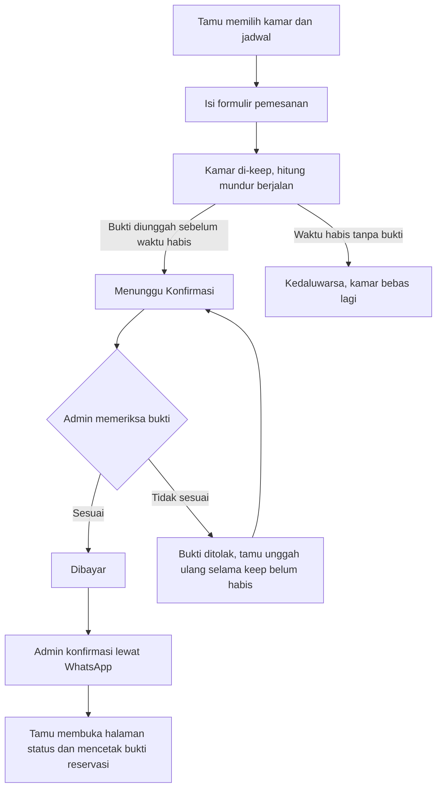
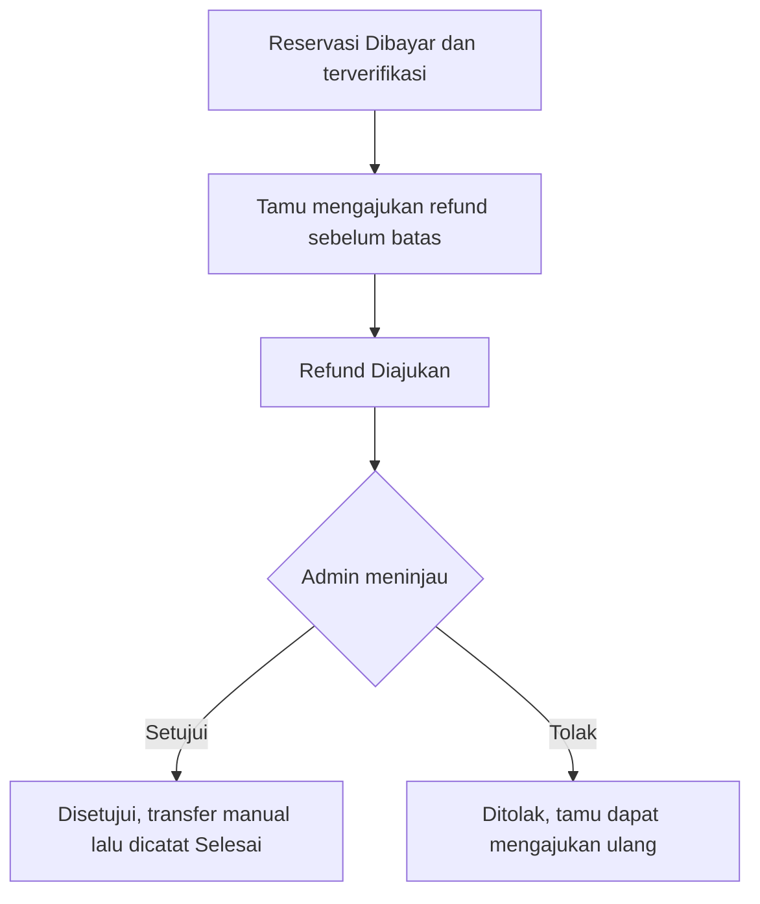
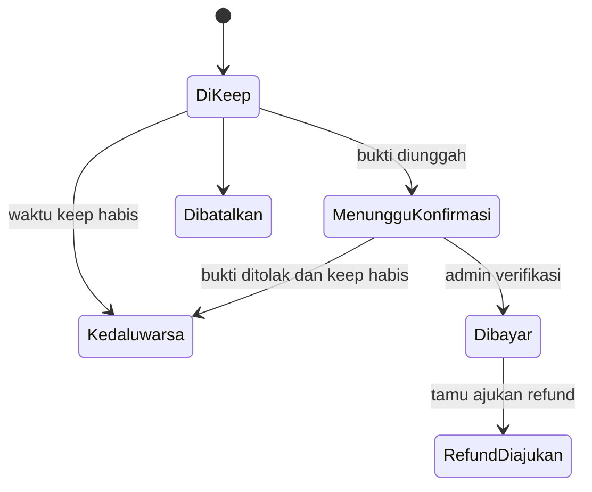

# Sistem Reservasi Villa D-R Jionsi

Website katalog dan reservasi kamar untuk Villa D-R Jionsi (Songgokerto, Kota Batu, Jawa Timur). Tamu dapat melihat kondisi kamar, menahan (keep) kamar sementara, membayar lewat QRIS statis, mengunggah bukti pembayaran, dan memantau status reservasi tanpa membuat akun. Pengelola villa memverifikasi pembayaran, meninjau refund, dan mengelola kamar lewat panel admin.

Proyek ini dikerjakan oleh Kelompok 3 SIB-2B sebagai Project-Based Learning (PBL) Semester 3, Program Studi D4 Sistem Informasi Bisnis, Politeknik Negeri Malang.

  

## Status Proyek

**Tahap saat ini: Milestone 2 (Minggu 12).**

| Sudah berjalan | Belum / belum lengkap |
|---|---|
| Katalog dan detail kamar, keep dengan hitung mundur, formulir reservasi, QRIS dan unggah bukti, cek status, pengajuan refund | Pengujian otomatis (belum ada folder `tests/`) |
| Panel admin: login, dashboard, reservasi, bukti pembayaran, refund, kelola kamar, master fasilitas, pengaturan | Berkas `.env.example` (belum ada di repositori) |
| Proteksi pemesanan ganda dan kedaluwarsa keep otomatis | - |

Aplikasi **belum di-deploy**. Demo dijalankan secara lokal dengan server bawaan PHP di `http://localhost:8000`.

## Daftar Isi

1. [Fitur](#fitur)
2. [Alur Utama](#alur-utama)
3. [Siklus Status Reservasi](#siklus-status-reservasi)
4. [Teknologi dan Arsitektur](#teknologi-dan-arsitektur)
5. [Basis Data](#basis-data)
6. [Instalasi dan Menjalankan Secara Lokal](#instalasi-dan-menjalankan-secara-lokal)
7. [Panduan Demo](#panduan-demo)
8. [Pengujian](#pengujian)
9. [Rilis dan Tag](#rilis-dan-tag)
10. [Panduan Kerja Tim](#panduan-kerja-tim)
11. [Format Pesan Commit](#format-pesan-commit)
12. [Catatan Riwayat Commit dan Kontribusi](#catatan-riwayat-commit-dan-kontribusi)
13. [Tim](#tim)
14. [Lisensi dan Catatan Akademik](#lisensi-dan-catatan-akademik)

## Fitur

### Pelanggan (tanpa login)

| Fitur | Keterangan |
|---|---|
| Katalog kamar | Filter check-in, durasi, kapasitas, dan fasilitas cepat (misalnya air panas, Wi-Fi). Status kamar Tersedia, Di-Keep, atau Terisi. |
| Detail kamar | Galeri foto, jadwal yang sudah dipesan, tarif per durasi, dan transparansi kondisi kamar (kebersihan dan kondisi fisik beserta tanggal pembaruan). |
| Keep kamar | Kamar ditahan sementara dengan hitung mundur (bawaan 15 menit, diatur di Pengaturan). |
| Formulir pemesanan | Data pemesan, pembayaran, lalu selesai. |
| Pembayaran | Pembayaran penuh lewat QRIS statis (unduh gambar QRIS) dan unggah bukti (maks. 2 MB, JPG/PNG/WEBP). |
| Cek status | Memakai kode booking dan 4 digit terakhir WhatsApp. Halaman hasil dapat dicetak sebagai bukti reservasi lewat fitur cetak peramban. |
| Refund | Pengajuan dengan alasan dan data rekening tujuan. |
| Profil villa | Profil, fasilitas, lokasi, dan ketentuan menginap. |

### Admin / pengelola (wajib login)

| Fitur | Keterangan |
|---|---|
| Login | Username dan kata sandi, IP dikunci 5 menit setelah 3 kali gagal, opsi "Ingat perangkat selama 14 hari". |
| Dashboard | Ringkasan kamar (tersedia, di-keep, terisi, dalam perbaikan), reservasi menunggu konfirmasi, refund menunggu tinjauan, daftar bukti pembayaran menunggu verifikasi, dan notifikasi. |
| Reservasi | Filter status, pencarian, rentang tanggal, ekspor laporan Excel (.xlsx), dan tombol konfirmasi ke tamu lewat WhatsApp. |
| Refund | Meninjau pengajuan (setujui atau tolak) dan mencatat hasilnya. Transfer dilakukan manual, sistem hanya mencatat. |
| Kelola kamar | Tambah, ubah, hapus lunak, foto, harga, deskripsi, status, dan catatan kondisi. Unduh laporan Excel/CSV. |
| Master fasilitas | Kelola fasilitas per kategori dan hubungkan ke kamar. |
| Pengaturan | Info villa, nomor WhatsApp, email operasional, batas keep, batas refund, foto profil dan hero, serta QRIS aktif dengan riwayat. |

## Alur Utama



Alur refund:



## Siklus Status Reservasi

Nama status diambil dari `CHECK` pada tabel `reservasi` di `database/schema.sql`.

| Status | Arti | Perubahan berikutnya |
|---|---|---|
| Di-Keep | Kamar ditahan, belum ada bukti | Menunggu Konfirmasi (bukti diunggah), Kedaluwarsa (waktu habis), Dibatalkan |
| Menunggu Konfirmasi | Bukti sudah diunggah, menunggu admin | Dibayar (bukti sesuai), Kedaluwarsa (bukti ditolak dan waktu keep habis) |
| Dibayar | Pembayaran terverifikasi | Refund Diajukan |
| Kedaluwarsa | Keep habis tanpa pembayaran valid | Akhir |
| Dibatalkan | Dibatalkan | Akhir |
| Refund Diajukan | Tamu mengajukan refund | Hasil tercatat pada tabel `refund` (Diajukan, Disetujui, Ditolak, Selesai) |



Setiap perubahan status dicatat di tabel `log_status_reservasi`.

### Aturan bisnis (dari kode)

| Aturan | Nilai | Sumber |
|---|---|---|
| Durasi keep | 15 menit (bawaan, dapat diubah di Pengaturan) | `pengaturan_villa.batas_waktu_keep_menit` |
| Pembayaran | Penuh, lewat QRIS statis | `app/public_helpers.php` |
| Paket durasi | 3, 6, 12, 24 jam, atau kelipatan 24 jam sampai 30 malam | `DURATION_PACKAGES`, `MAX_BOOKING_NIGHTS` |
| Batas refund | Sampai `batas_refund_hari_sebelum` hari (bawaan 1) setelah reservasi dibuat, atau sampai waktu check-in, mana yang lebih dulu | `refund_deadline()` |
| Format kode booking | `<KODE_PROPERTI>-<YYYYMMDD check-in>-K<nomor kamar>-<4 hex acak>`, contoh `DRJ-20261120-K202-E024` | `create_booking()` |

### Mekanisme pencegahan pemesanan ganda dan kedaluwarsa

- **Pemesanan ganda:** `create_booking()` berjalan dalam satu transaksi dan mengunci baris kamar dengan `SELECT ... FOR UPDATE`. Lapisan terakhir ada di database: constraint `no_double_booking` (`EXCLUDE USING gist` pada `kamar_id` dan `tsrange(waktu_checkin, waktu_checkout)`) berlaku untuk status Di-Keep, Menunggu Konfirmasi, dan Dibayar. Pelanggaran (kode SQLSTATE `23P01`) ditangkap dan ditampilkan sebagai pesan jadwal sudah terpakai.
- **Kedaluwarsa otomatis:** fungsi `expire_keeps()` mengubah reservasi yang batas keep-nya lewat menjadi Kedaluwarsa dan mencatat log. Fungsi ini dipanggil setiap halaman terkait dimuat (beranda, detail, formulir, keep, status, dashboard dan reservasi admin), bukan lewat cron.

## Teknologi dan Arsitektur

| Komponen | Teknologi |
|---|---|
| Bahasa | PHP native, `declare(strict_types=1)`, minimal PHP 8.0 (memakai `match`) |
| Basis data | PostgreSQL via PDO (`pdo_pgsql`), ekstensi `btree_gist` dan `pgcrypto` |
| Tampilan | HTML5, Bootstrap 5.3.2 dan Bootstrap Icons 1.11.1 (CDN), CSS dan JavaScript sendiri |
| Server pengembangan | Server bawaan PHP (`php -S`) |

### Struktur folder

```
villa-dr-jionsi/
├── app/                      # Logika aplikasi (fungsi PHP prosedural) dan tampilan
│   ├── public_helpers.php    # Sesi, CSRF, keep, booking, unggah bukti, refund tamu
│   ├── admin_auth.php        # Login admin, sesi, penguncian login gagal
│   ├── admin_dashboard.php   # Data dashboard admin
│   ├── admin_reservasi.php   # Logika pengelolaan reservasi
│   ├── admin_kamar.php       # CRUD kamar, foto, laporan Excel/CSV
│   ├── admin_fasilitas.php   # Master fasilitas
│   ├── admin_refund.php      # Peninjauan refund
│   ├── admin_settings.php    # Pengaturan villa dan QRIS
│   └── views/                # Template: layouts, home, kamar, reservasi, profil, admin, partials
├── config/db.php             # Pemuat .env dan koneksi PDO
├── database/                 # Skema, data awal, dan skrip migrasi (lihat Basis Data)
├── public/                   # Satu-satunya folder yang diakses peramban (document root)
│   ├── *.php                 # Titik masuk tiap halaman
│   ├── assets/               # css, js, img
│   └── uploads/              # Foto kamar, hero, dan profil villa
├── storage/bukti-pembayaran/ # Bukti pembayaran tamu (tidak di-commit)
└── .gitignore
```

### Pola arsitektur

Aplikasi memakai pemisahan bergaya MVC yang sederhana, bukan kerangka kerja MVC dengan router dan kelas:

- **Titik masuk (mirip controller):** berkas di `public/*.php` menerima permintaan, memanggil fungsi di `app/`, lalu memuat view.
- **Model/logika:** fungsi di `app/*.php` yang mengakses database lewat PDO dan menjalankan aturan bisnis.
- **View:** template di `app/views/`, dengan `layouts/` untuk kerangka halaman bersama.

## Basis Data

Tabel dari `schema.sql`:

| Tabel | Fungsi |
|---|---|
| `admin_users` | Akun pengelola (kata sandi di-hash) |
| `login_percobaan` | Pencatatan login gagal per IP untuk penguncian |
| `pengaturan_villa` | Satu baris pengaturan (keep, refund, kontak) |
| `qris_statis` | Gambar QRIS; hanya satu yang boleh aktif |
| `kamar` | Data kamar (status Tersedia, Terisi, Perbaikan; hapus lunak) |
| `reservasi` | Pemesanan, termasuk constraint anti tumpang tindih |
| `pembayaran` | Bukti pembayaran dan status verifikasi (Menunggu, Terverifikasi, Ditolak) |
| `refund` | Pengajuan refund |
| `log_status_reservasi` | Riwayat perubahan status |

Tabel tambahan: `harga_paket_jam` (dari `harga_paket.sql`), `fasilitas` (dari `migrasi_fasilitas.sql`), dan `fasilitas_kamar` (dibuat otomatis oleh aplikasi saat pertama dibutuhkan).

Relasi utama: `reservasi.kamar_id` ke `kamar`; `pembayaran`, `refund`, dan `log_status_reservasi` ke `reservasi`; `pembayaran.qris_id` ke `qris_statis`; `fasilitas_kamar` menghubungkan `fasilitas` dan `kamar`.

| Berkas di `database/` | Fungsi |
|---|---|
| `schema.sql` | DDL semua tabel inti |
| `seed.sql` | Data awal: admin, pengaturan, QRIS, 6 kamar. Tanpa data reservasi. |
| `harga_paket.sql` | Tabel harga paket 3/6/12 jam dan penyamaan harga kamar |
| `migrasi_fasilitas.sql` | Membuat tabel `fasilitas` beserta data awal |
| `migrasi_refund_rekening.sql` | Kolom rekening pada `refund` (juga ditambahkan otomatis oleh aplikasi) |
| `migrasi_login.sql`, `migrasi_kamar.sql`, `migrasi_reservasi.sql` | Hanya untuk memperbarui database lama |
| `bersihkan_reservasi.sql` | Mengosongkan semua data reservasi di database lokal |
| `dr-jionsi.sql` | Dump database |


## Instalasi dan Menjalankan Secara Lokal

### Prasyarat

- PHP 8.0 atau lebih baru dengan ekstensi `pdo_pgsql`, `pgsql`, `mbstring`, `fileinfo` (aktifkan `zip` agar unduhan kamar dan fasilitas berformat `.xlsx`)
- PostgreSQL 13 atau lebih baru
- Git

### Langkah

1. Clone repositori.

   ```bash
   git clone https://github.com/robbydio-123/villa-dr-jionsi.git
   cd villa-dr-jionsi
   ```

2. Buat berkas `.env` di akar proyek (berkas `.env.example` belum tersedia, jadi buat manual) dengan isi berikut, lalu sesuaikan dengan PostgreSQL lokal Anda. Jangan pernah meng-commit `.env`.

   ```ini
   APP_ENV=development
   APP_TIMEZONE=Asia/Jakarta
   DB_HOST=localhost
   DB_PORT=5432
   DB_NAME=jionsi_db
   DB_USER=postgres
   DB_PASS=kata_sandi_postgresql_anda
   ```

3. Buat database lalu jalankan berkas SQL **berurutan**.

   ```bash
   createdb -U postgres jionsi_db
   psql -U postgres -d jionsi_db -f database/schema.sql
   psql -U postgres -d jionsi_db -f database/seed.sql
   psql -U postgres -d jionsi_db -f database/harga_paket.sql
   psql -U postgres -d jionsi_db -f database/migrasi_fasilitas.sql
   ```

4. Jalankan server.

   ```bash
   php -S localhost:8000 -t public
   ```

5. Buka aplikasi.

   | Halaman | Alamat |
   |---|---|
   | Pelanggan | http://localhost:8000 |
   | Admin | http://localhost:8000/login.php |

   Akun admin untuk uji dibuat oleh `database/seed.sql`. Ganti kata sandi bawaan sebelum aplikasi dipakai di server sungguhan.

### Masalah umum

| Pesan | Solusi |
|---|---|
| `could not find driver` | Aktifkan `extension=pdo_pgsql` dan `extension=pgsql` di `php.ini` |
| `Koneksi database gagal` | Periksa nilai `DB_*` di `.env` |
| `relation "..." does not exist` | Ulangi langkah 3 sesuai urutan, atau jalankan skrip `migrasi_*.sql` yang sesuai pada database lama |
| Unduhan menjadi `.csv`, bukan `.xlsx` | Aktifkan `extension=zip` di `php.ini` |

Membuat ulang database dari nol: `dropdb -U postgres jionsi_db`, lalu ulangi langkah 3.

## Panduan Demo

1. Buka beranda, pilih tanggal check-in dan durasi, terapkan filter, lalu buka detail satu kamar.
2. Tekan tombol keep, isi formulir (nama, WhatsApp, jumlah tamu, persetujuan kebijakan), dan perhatikan hitung mundur.
3. Pada halaman pembayaran, unduh QRIS lalu unggah bukti (gambar uji). Catat kode booking.
4. Buka `login.php`, masuk sebagai admin, lalu buka Bukti Pembayaran dan Reservasi. Verifikasi bukti sehingga status menjadi Dibayar.
5. Tekan tombol WhatsApp untuk konfirmasi ke tamu.
6. Sebagai tamu, buka Cek Status dengan kode booking dan 4 digit terakhir WhatsApp, lalu cetak bukti reservasi.
7. Ajukan refund dari halaman refund, lalu tinjau dan putuskan sebagai admin.
8. Untuk menunjukkan kedaluwarsa: buat satu keep dan biarkan waktunya habis tanpa unggah bukti.

## Pengujian

Belum ada pengujian otomatis dan belum ada folder tes di repositori. Pengujian saat ini manual mengikuti Panduan Demo.


## Rilis dan Tag

Versi Milestone 2 ditandai dengan git tag `milestone-2`. Isi di balik tag tidak diubah setelah batas pengumpulan.

## Panduan Kerja Tim

Repositori ini hanya memakai **satu branch, yaitu `main`**. Tidak ada branch `develop` maupun branch fitur, dan tidak memakai Pull Request. Semua anggota commit dan push langsung ke `main`. Karena itu, disiplin pada langkah di bawah wajib dijaga supaya `main` selalu bisa dijalankan.

### 1. Sebelum mulai mengerjakan

Selalu ambil perubahan terbaru dari teman setim:

```bash
git checkout main
git pull origin main
```

### 2. Kerjakan, commit, dan push

```bash
# 1. Periksa file yang berubah
git status

# 2. Tambahkan ke staging (pilih file yang dikerjakan, hindari .env)
git add public/index.php app/views/kamar/

# 3. Commit dengan format yang disepakati
git commit -m "feat(katalog): tampilkan kamar dari database"

# 4. Ambil perubahan terbaru lagi sebelum push
git pull --rebase origin main

# 5. Kirim ke GitHub
git push origin main
```

### 3. Aturan kerja langsung di main

- Jalankan `git pull origin main` **sebelum mulai** dan **sebelum push**.
- Tes dulu di lokal. Jangan push kode yang membuat aplikasi error.
- Commit kecil dan sering. Satu commit memuat satu perubahan yang jelas.
- Beri tahu di grup bila akan mengubah berkas yang sering dipakai bersama (misalnya `style.css`, `schema.sql`, `db.php`) agar tidak bentrok.
- Bila terjadi konflik saat `git pull --rebase`, selesaikan konfliknya, jalankan `git add` pada berkas yang diperbaiki lalu `git rebase --continue`. Bila ragu, tanyakan ke Project Manager.
- Dilarang `git push --force` ke `main`.
- Perubahan skema database (`schema.sql`) wajib diinfokan ke seluruh tim, karena setiap anggota perlu membuat ulang database lokalnya. Bila perubahan itu juga menyentuh database yang sudah berjalan, sertakan berkas migrasi (seperti `migrasi_login.sql`) di folder `database/`.
- Pada setiap milestone, Project Manager membuat tag di `main` (contoh `milestone-2` dan `v1.0-final`):

  ```bash
  git tag milestone-2
  git push origin milestone-2
  ```

## Format Pesan Commit

Format: `tipe(scope): deskripsi singkat`. Scope bersifat opsional.

- `feat`: menambah fitur baru.
  - Contoh: `feat(cart): add checkout button to shopping cart`
- `fix`: memperbaiki bug atau error (tambahkan scope di dalam kurung).
  - Contoh: `fix(auth): resolve token expiration issue on login`
- `docs`: mengubah atau menambah dokumentasi.
  - Contoh: `docs(readme): update installation steps`
- `chore`: tugas pemeliharaan, setup, atau hal di luar kode utama.
  - Contoh: `chore: setup struktur folder proyek`
- `refactor`: merapikan atau mengubah struktur kode tanpa mengubah fungsi.
  - Contoh: `refactor(api): simplify user data fetching logic`
- `style`: perubahan format atau spasi yang tidak mengubah logika kode.
  - Contoh: `style: fix indentation in navbar component`

## Catatan Riwayat Commit dan Kontribusi

Tim mengerjakan proyek ini bersama-sama dengan VS Code Live Share. Pada sesi seperti itu, perubahan dari semua anggota tersimpan di komputer host, sehingga `git commit` dan `git push` dilakukan dari akun host. Akibatnya, riwayat commit dan halaman Contributors di GitHub tidak mencerminkan kontribusi seluruh anggota. Jumlah commit seorang anggota di GitHub bukan ukuran kontribusinya.

Untuk menelusuri siapa mengerjakan apa:

- Commit hasil sesi Live Share mencantumkan nama anggota yang ikut mengerjakan lewat baris `Co-authored-by` pada pesan commit (lihat [Format Pesan Commit](#format-pesan-commit) dan `CONTRIBUTING.md`).
- Logbook mingguan mencatat kolom "Dikerjakan oleh" untuk setiap tugas.
- Pembagian peran tim ada pada bagian [Tim](#tim).

Anggota yang terlibat dalam pekerjaan yang di-push oleh host: Dewi Muji Rahayu, Gendis Kumala Ariga, Muhammad Afif Naufal, Daffa' Azzi Maulana A, dan Robby Dio Ramadhani.

## Tim

| Nama | Peran | Fokus tanggung jawab |
|---|---|---|
| Dewi Muji Rahayu | Project Manager, System Architect, Lead Backend Developer, Database Support | Mengarahkan proyek, merancang arsitektur, dan memimpin backend serta basis data. |
| Gendis Kumala Ariga | Sekretaris dan Documenter | Mencatat rapat dan menyusun dokumentasi proyek. |
| Muhammad Afif Naufal | Backend Developer dan Frontend Supporter | Mengerjakan logika backend dan membantu implementasi tampilan. |
| Daffa' Azzi Maulana A | UI/UX Designer dan Lead Frontend Developer | Merancang desain dan memimpin implementasi frontend. |
| Robby Dio Ramadhani | Quality Assurance dan Frontend Assistant | Menguji aplikasi dan membantu pekerjaan frontend. |

## Lisensi dan Catatan Akademik

Proyek ini dibuat untuk keperluan akademik Politeknik Negeri Malang. Penggunaan AI sebagai alat bantu dideklarasikan di laporan proyek.